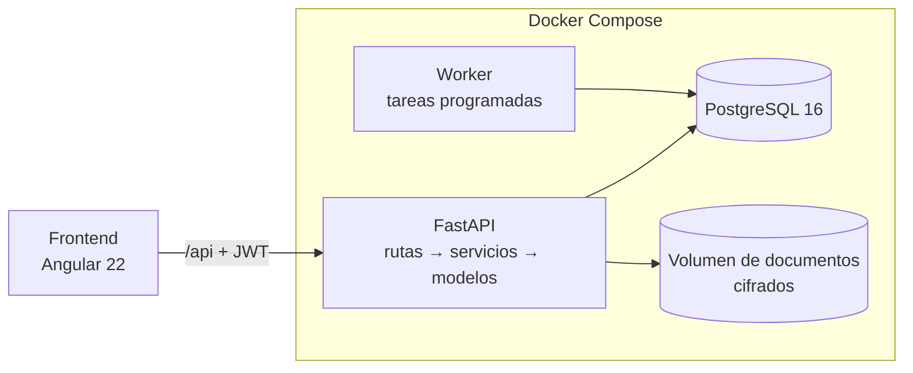

# Dragones — Plataforma de gestión para un club de voleibol

[](https://github.com/JPosada24/dragones_dashboard/actions/workflows/ci.yml)


Sistema para administrar un club deportivo real: alumnos y acudientes, inscripciones con plazos de pago,
abonos, documentos y, en las próximas fases, asistencia, multas, rifas y torneos. Reemplaza las hojas de
cálculo y los mensajes sueltos por un registro único, auditable y con permisos por rol.

> Proyecto en desarrollo activo: el **backend está completo** (todas las reglas del club) y el **frontend en
> Angular** está en construcción, pantalla por pantalla. Los datos de las pruebas son inventados.

## Qué resuelve

| Necesidad del club | Cómo lo resuelve |
|---|---|
| Saber quién está inscrito y quién debe | Inscripción con valor y plazo configurables, **abonos parciales**, saldo y estados (pendiente → activo → a expulsar → expulsado) |
| Que nadie "acomode" los pagos | Abonos, prórrogas y bitácora **de solo agregar** (un trigger de PostgreSQL impide editarlos o borrarlos). Un error se corrige con una anulación que deja rastro |
| Proteger datos de menores | Documento de identidad y archivos **cifrados en reposo**; los menores exigen acudiente |
| Controlar la asistencia | Sesiones por rama, marcación del entrenador o del propio alumno (solo en el horario), justificaciones con revisión y **cierre diario** que genera ausencias y multas automáticamente |
| Rifas sin enredos | Un talonario por alumno, pagos por puesto o completos, **sorteo automático** solo entre talonarios pagados, con acta inmutable verificable por su huella SHA-256 |
| Organizar torneos | Inscripción de clubes externos con cupo, **lista de espera automática** y abonos hasta confirmar |
| Avisar sin pagar mensajería | Correo automático, avisos en la plataforma y **WhatsApp con un clic** (enlace con el mensaje listo desde el número del club): recordatorios de pago, multas, justificaciones y alertas de inasistencia |
| Deudas que se eternizan | **Mora automática**: una deuda con 3 meses (configurable) deja la inscripción «a expulsar» para que el dueño confirme; aviso previo a la familia y vuelta a activo al pagar |
| ¿Quién está a paz y salvo? | Estado de cuenta por alumno: inscripción, multas y rifas en un solo número |
| Varios entrenadores, dos ramas | Permisos por rol verificados en el servidor; un entrenador asistente solo ve su rama |
| Reglas que cambian | Montos, plazos, edades y límites viven en la tabla `configuracion`, editable por el dueño |

## Arquitectura



- **Capas:** `api/v1` (rutas y permisos) → `services` (reglas de negocio) → `models` (SQLAlchemy 2).
  La validación de entrada y salida está en `schemas` (Pydantic v2).
- **Migraciones:** Alembic; las pruebas construyen el esquema con las migraciones reales, así que cada
  migración y cada trigger quedan probados.
- **Worker:** un contenedor aparte corre las tareas programadas (cierre diario de asistencia, vencimiento de
  inscripciones, mora, recordatorios y envío de correos con reintentos). Son idempotentes y un *advisory lock* de PostgreSQL evita ejecutarlas dos veces a la vez.
- **Errores de negocio:** excepciones propias (`services/errores.py`) que se traducen a HTTP con mensajes
  pensados para el usuario final ("La fecha de pago supera el plazo de 30 días…").

## Seguridad

La seguridad está en el diseño y en las pruebas, no en ocultar el código:

- **Autenticación:** contraseñas con Argon2id; access token JWT de 15 min con algoritmo fijo; refresh token
  opaco y rotativo en cookie `HttpOnly` + `SameSite=Strict`, con **detección de reutilización** (si se usa un
  token ya rotado se revoca toda la cadena). Bloqueo por cuenta tras 5 fallos y límite de fallos por IP.
- **Autorización:** cada ruta declara su permiso y el servicio aplica el alcance (todos / su rama / los
  propios). Un recurso ajeno responde 404, para no revelar que existe.
- **Datos sensibles:** el número de documento se guarda cifrado (Fernet) con un **índice ciego** (HMAC) para
  buscar y evitar duplicados sin descifrar. En las respuestas sale enmascarado; verlo completo queda auditado.
- **Archivos:** solo PDF/JPG/PNG validados por su contenido real, con tamaño máximo, cifrados y servidos como
  descarga (`attachment`, `nosniff`, `no-store`).
- **Abuso:** tope de tamaño por petición (413) que también corta envíos *chunked*.
- **Secretos:** solo en `.env` (fuera de git). Un hook de pre-commit y el job de **gitleaks** en el CI frenan
  cualquier clave que intente colarse.
- **Producción:** la app se niega a arrancar con cookies no seguras o claves de ejemplo, y apaga la
  documentación interactiva.

## Pruebas

**168 pruebas** contra un PostgreSQL real; cubren cada regla de negocio y, sobre todo, **qué rol NO puede**
hacer qué (por ejemplo: un entrenador no inscribe alumnos de otra rama, un acudiente no ve a otros niños,
el Admin no confirma expulsiones). Las reglas con hora (cierre de las 11:59 pm, ventana para marcar
asistencia) se prueban con un reloj simulado.

## Cómo correrlo

Requisito: Docker Desktop.

```powershell
copy .env.example .env      # luego edita los valores marcados "CAMBIA"
docker compose up --build
```

Genera las claves sin instalar Python:

```powershell
docker compose run --rm --no-deps api python -c "import secrets; print(secrets.token_urlsafe(48))"
docker compose run --rm --no-deps api python -c "from cryptography.fernet import Fernet; print(Fernet.generate_key().decode())"
```

> **Guarda `DATA_ENCRYPTION_KEY` en un lugar seguro.** Si se pierde, los datos cifrados no se recuperan.
> En `POSTGRES_PASSWORD` usa solo letras y números (va dentro de una URL).

Al arrancar se aplican las migraciones y se crea el primer SuperAdmin con los datos de `.env`. Luego:

- **Aplicación:** <http://localhost:4300> (ingresa con `SUPERADMIN_EMAIL` y su clave)
- Documentación interactiva: <http://localhost:8000/api/docs> (o el puerto de `API_PORT`)
- Salud: <http://localhost:8000/api/v1/salud>

Pruebas (crean una base `<nombre>_test` aparte; no tocan tus datos):

```powershell
docker compose run --rm --user root api sh -c "pip install -q -r requirements-dev.txt && pytest"
```

Pruebas del frontend:

```powershell
docker compose exec frontend npx ng test --watch=false
```

Activa el hook que bloquea secretos (una vez por clon):

```powershell
git config core.hooksPath .githooks
```

## Estructura

```
backend/
  app/
    core/        configuración, seguridad, cifrado, límites, almacenamiento de archivos, permisos
    models/      tablas (acceso, alumnos, inscripciones, abonos, asistencia, multas, rifas, torneos,
                 notificaciones, auditoría)
    schemas/     validación de entradas y salidas
    services/    reglas de negocio
    api/v1/      rutas (auth, usuarios, configuración, alumnos, acudientes, inscripciones, sesiones,
                 justificaciones, multas, rifas, torneos, notificaciones, mora)
  alembic/       migraciones 0001–0009
  tests/         pruebas automatizadas
frontend/        Angular 22 (ver frontend/README.md)
.githooks/       pre-commit que bloquea secretos
.github/         CI: pruebas + gitleaks
```

## Hoja de ruta

- [x] Fase 1A — autenticación, roles, configuración y auditoría
- [x] Fase 1B — alumnos, acudientes, documentos, inscripciones, abonos y prórrogas
- [x] Fase 2 — sesiones, asistencia, justificaciones, cierre diario y multas
- [x] Worker de tareas programadas (cierre diario, vencimientos)
- [x] Fase 3A — rifas, sorteo con acta y estado de cuenta (paz y salvo)
- [x] Fase 3B — torneos con clubes externos, cupo y lista de espera
- [x] Notificaciones: correo, bandeja y WhatsApp con enlace
- [x] Mora automática por deudas sin pagar
- [x] Frontend F1 — ingreso, marco con menú por permisos, avisos
- [ ] Frontend: una pantalla por sección (Resumen, Asistencia, Alumnos, Inscripciones, …)
- [ ] Sitio público del club · asistente con IA · despliegue

## Licencia

[MIT](LICENSE) © 2026 Julian Posada
